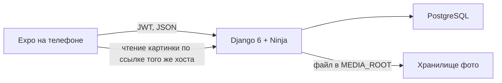

# Архитектура приложения «Поток»

Стек и границы системы. Поведение продукта описано в `spec.md`.

## 1. Состав

| Часть | Технология | Роль |
| --- | --- | --- |
| Мобильный клиент | Expo (React Native), TypeScript, Expo Router | Экраны витрины, товара, заявки и кабинета продавца |
| API | Django 6.1.3+, Django Ninja 1.8, Python 3.15 | Правила заказа, доступ, OpenAPI |
| База | PostgreSQL 18.7+ | Витрины, товары, районы, заказы, заявки |
| Файлы | Каталог `MEDIA_ROOT`, стандартное хранилище Django | Фото товаров |
| Доступ | JWT | Запросы с телефона |

Клиент ходит только в HTTP API. В клиенте нет правила приёма заказа и нет прямого доступа к базе. Фото он читает по ссылке, которую вернул API.

Оплата, маршруты, слоты доставки, чат, рейтинги, пуши и модерация в эту архитектуру не входят. Сообщение району о набранном минимуме — запись в базе, телефон забирает её следующим запросом.

## 2. Как связаны части



Обновление хода набора — повторный запрос карточки заказа с экрана товара. Отдельный канал в реальном времени не нужен.

## 3. Репозиторий

```text
backend/          Django-проект
mobile/           Expo-приложение
spec.md
structure.md
agents.md
```

Бэкенд и клиент деплоятся отдельно. Общий контракт — OpenAPI, который отдаёт Ninja.

## 4. Бэкенд

Один Django-проект, одно API Ninja. Синхронные вьюхи и обычные транзакции Django.

Слои:

- **модели** — таблицы и ограничения;
- **сервисы** — создание заявки и приём заказа;
- **API** — схемы Pydantic, проверка JWT, вызов сервиса.

Правило «сумма достигла минимума» живёт в сервисе, не в клиенте и не в сериализаторе.

Каталоги:

```text
backend/
  config/                 настройки, корневой urls
  apps/
    accounts/             пользователь
    storefronts/          витрина и товары
    delivery/             районы и точка в заявке
    orders/               совместный заказ и заявки
  media_storage/          загрузка фото в MEDIA_ROOT и выдача ссылки
```

Админка Django используется для просмотра данных на старте. Покупатель и продавец работают из приложения.

Запуск: gunicorn с воркерами Django. Фоновые воркеры и Redis не требуются. Конец окна X проверяется при следующем чтении или записи заказа: если срок прошёл, статус становится `closed`. Новый `collecting` при этом не создаётся. Он появляется только со следующей заявки.

## 5. Данные

Один пользователь может быть продавцом и покупателем. Отдельных учётных записей на роли нет.

| Сущность | Смысл | Ключевые поля |
| --- | --- | --- |
| User | Учётная запись | телефон или email, пароль |
| Storefront | Одна витрина хозяйства | владелец, название |
| Product | Товар на витрине | витрина, описание, единица, минимум > 0, окно дозаказа X — целое число часов > 0 |
| ProductPhoto | Фото товара | товар, путь файла в `MEDIA_ROOT` |
| District | Район доставки продавца | витрина, название |
| ProductDistrict | Районы, куда везут этот товар | товар, район |
| GroupOrder | Совместный заказ на товар | товар, статус `collecting`, `topup` или `closed`, набранное количество, момент набора минимума, конец окна X, снимок минимума и единицы на момент набора |
| OrderLine | Заявка покупателя | заказ, покупатель, количество > 0, район, текст точки |
| DistrictNotice | Сообщение району | район, заказ, текст, момент создания |

Ограничения:

- у пользователя не больше одной витрины;
- у товара не больше одного заказа в статусе `collecting` или `topup`;
- единица количества одна на товар, заявки этого заказа суммируются в ней же;
- район в заявке входит в районы этого товара;
- в `collecting` покупатель может удалить свою заявку, сумма уменьшается;
- с переходом в `topup` отмена закрыта, новые заявки принимаются до конца X;
- после `closed` строки заказа не добавляются и не меняются;
- фото, описание, районы, минимум и X можно менять, пока текущий заказ `collecting` или открытого заказа нет; единица после создания товара не меняется;
- район нельзя снять с товара, пока на него есть строка текущего `collecting`;
- заявка не принимается, если у товара нет описания или ни одного фото;
- число участников — число разных покупателей заказа, а не число строк;
- если в `collecting` правка минимума делает сумму больше или равной новому минимуму, заказ в этой же транзакции переходит в `topup`: пишутся снимок минимума и единицы, конец X и `DistrictNotice` на каждый район товара.

Район — запись с названием, которую завёл продавец. Точка — выбранный район плюс адрес текстом. Покупатель не может указать район вне списка товара, поэтому геопроверка и PostGIS не используются.

Количество хранится как `NUMERIC`. Деньги в модели нет.

## 6. Приём заявки

Одна операция в транзакции с блокировкой строки `GroupOrder`:

1. Если у товара есть заказ `topup` и его окно X уже прошло, поставить этому заказу `closed`.
2. Найти заказ товара в статусе `collecting` или `topup`. Если его нет, создать `collecting`.
3. Заблокировать эту строку.
4. Отклонить заявку, если статус `closed` или окно X уже прошло.
5. Отклонить заявку, если у товара нет описания или ни одного фото, район не входит в районы товара или количество не больше нуля.
6. Записать заявку и прибавить количество к сумме заказа.
7. Если статус был `collecting` и сумма больше или равна минимуму, поставить `topup`, записать снимок минимума и единицы, конец окна X и создать `DistrictNotice` на каждый район этого товара.
8. Вернуть клиенту статус, число разных покупателей, набранное количество, остаток до минимума и конец окна, если минимум уже набран.

Отмена — отдельная операция в такой же блокировке. Она разрешена только в `collecting`: строка заявки удаляется, количество вычитается. В `topup` и `closed` отмена возвращает `409`.

Пока заказ `collecting` или `topup` и окно не истекло, покупатель может добавить ещё одну заявку. Она снова проходит эту операцию и увеличивает сумму. Если у этого покупателя уже есть строка в заказе, число участников не меняется.

## 7. API

Префикс `/api/`. Схема для клиента: `/api/docs`.

Доступ по заголовку `Authorization: Bearer`.

| Метод и путь | Кто | Что делает |
| --- | --- | --- |
| `POST /api/auth/register` | гость | регистрация |
| `POST /api/auth/token` | гость | выдача JWT |
| `GET /api/storefronts` | любой вошедший | список витрин |
| `POST /api/storefronts` | продавец | создать свою витрину |
| `GET /api/storefronts/{id}` | любой вошедший | витрина и товары |
| `POST /api/products` | владелец витрины | создать товар |
| `PATCH /api/products/{id}` | владелец | описание, минимум и X, пока заказ `collecting` или открытого заказа нет; единица не меняется; снижение минимума может перевести заказ в `topup` |
| `POST /api/products/{id}/photos` | владелец | загрузка фото, пока заказ `collecting` или открытого заказа нет |
| `PUT /api/products/{id}/districts` | владелец | районы товара, пока заказ `collecting` или открытого заказа нет; район со строкой текущего сбора снять нельзя |
| `GET /api/products/{id}` | любой вошедший | товар и ход открытого заказа; если его нет, ход пустой |
| `POST /api/products/{id}/lines` | покупатель | заявка: количество, район, текст точки |
| `DELETE /api/lines/{id}` | автор заявки | отмена, только пока заказ `collecting` |
| `GET /api/orders/{id}` | участник или владелец | состав текущего, добираемого или закрытого заказа |
| `GET /api/districts/{id}/notices` | любой вошедший | сообщения района, в том числе о набранном минимуме |

Пока есть заказ `collecting` или `topup`, ответ карточки товара содержит его ход: статус, число разных покупателей, сумму, минимум, остаток, включён ли блок отмены и до какого времени ещё можно дозаказать. Если открытого заказа нет, эти поля пустые. Закрытый заказ читается отдельно, `GET /api/orders/{id}`, и отдаёт запомненные минимум и единицу.

Ошибки — JSON с кодом HTTP. Чужая точка, чужой товар, отмена после минимума и заявка в закрытый заказ приходят как `400` или `409`, без частичной записи.

## 8. Фото

Клиент отправляет файл на `POST /api/products/{id}/photos`. Django проверяет владельца и тип файла, кладёт его в `MEDIA_ROOT` через `django.core.files.storage` и сохраняет путь.

S3 и пакет `django-storages` не используются. В ответах API у фото ссылка на тот же хост, что и API. Локально это IP машины и порт Django, на сервере файл отдаёт nginx из каталога на диске. gunicorn файлы не раздаёт. Каталог фото входит в бэкап вместе с базой. Позже бэкенд хранилища можно сменить настройкой, не меняя ручку загрузки.

## 9. Клиент

Expo Router, TypeScript, стили через `StyleSheet`. Состояние экранов локальное. Общего стора нет.

```text
mobile/
  app/                экраны Expo Router
  src/api/            функции по ручкам OpenAPI
  src/auth/           хранение JWT
  src/components/     кнопки, карточки, формы
```

Экраны:

- вход и регистрация;
- список витрин и карточка витрины;
- товар: фото, описание, ход набора, окно дозаказа, форма заявки и отмена, пока сбор не набран;
- сообщение района о набранном минимуме;
- кабинет продавца: витрина, товар, фото, районы, минимум;
- состав заказа для продавца и участника.

Экран показывает загрузку и текст ошибки с API. После успешной заявки он заново запрашивает карточку товара.

Строка Postgres в клиент не попадает. Отдельных ключей хранилища нет.

## 10. Окружение

Локально на Windows репозиторий лежит в файловой системе WSL2, не на диске `C:`.

- В WSL2: Postgres, установленный в сам дистрибутив, и Django (`runserver`). Django ходит в базу по `localhost`. Так же устроен сервер: Linux, Postgres, процесс Django.
- В Windows: Metro и Expo. Телефон с Expo Go в одной сети с компьютером открывает API по IP этой машины и порту Django из WSL.

Docker не используется. Отдельный Postgres в Windows не используется.

На сервере: gunicorn, Postgres 18.7 или новее на той же машине и каталог фото на её диске. Процесс Django — Python 3.15 и Django 6.1.3 или новее. nginx отдаёт каталог фото. Настройки — переменные окружения: `DATABASE_URL`, секрет JWT, путь `MEDIA_ROOT`.

Для VPS на 2 ядра и 4 ГБ, где Django и Postgres стоят вместе, gunicorn запускают с 3 синхронными воркерами. Ориентир нагрузки — около 50 запросов к API в секунду постоянно и короткий пик около 100. Это оценка по этой схеме, не замер. Фото nginx отдаёт мимо Django, в эту цифру они не входят. При обновлении карточки раз в 10 секунд 50 запросов в секунду — примерно 500 одновременно открытых экранов товара. Раньше этого запаса заканчиваются диск под фото и память Postgres.

Миграции применяет Django. Схема клиенту не отдаётся, клиент знает только JSON API.
