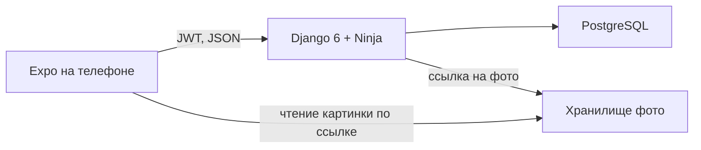

# Архитектура приложения «Поток»

Стек и границы системы. Поведение продукта описано в `spec.md`.

## 1. Состав

| Часть | Технология | Роль |
| --- | --- | --- |
| Мобильный клиент | Expo (React Native), TypeScript, Expo Router | Экраны витрины, товара, заявки и кабинета продавца |
| API | Django 6, Django Ninja | Правила заказа, доступ, OpenAPI |
| База | PostgreSQL | Витрины, товары, районы, заказы, заявки |
| Файлы | S3-совместимое хранилище, `django-storages` | Фото товаров |
| Доступ | JWT | Запросы с телефона |

Клиент ходит только в HTTP API. В клиенте нет правила приёма заказа и нет прямого доступа к базе и к хранилищу.

Оплата, маршруты, слоты доставки, чат, рейтинги, пуши и модерация в эту архитектуру не входят.

## 2. Как связаны части



Обновление хода набора — повторный запрос карточки заказа с экрана товара. Отдельный канал в реальном времени не нужен.

## 3. Репозиторий

```text
backend/          Django-проект
mobile/           Expo-приложение
spec.md
structure.md
agents.md
```

Бэкенд и клиент деплоятся отдельно. Общий контракт — OpenAPI, который отдаёт Ninja.

## 4. Бэкенд

Один Django-проект, одно API Ninja. Синхронные вьюхи и обычные транзакции Django.

Слои:

- **модели** — таблицы и ограничения;
- **сервисы** — создание заявки и приём заказа;
- **API** — схемы Pydantic, проверка JWT, вызов сервиса.

Правило «сумма достигла минимума» живёт в сервисе, не в клиенте и не в сериализаторе.

Каталоги:

```text
backend/
  config/                 настройки, корневой urls
  apps/
    accounts/             пользователь
    storefronts/          витрина и товары
    delivery/             районы и точка в заявке
    orders/               совместный заказ и заявки
  media_storage/          загрузка фото и выдача ссылки
```

Админка Django используется для просмотра данных на старте. Покупатель и продавец работают из приложения.

Запуск: gunicorn с воркерами Django. Фоновые воркеры и Redis не требуются.

## 5. Данные

Один пользователь может быть продавцом и покупателем. Отдельных учётных записей на роли нет.

| Сущность | Смысл | Ключевые поля |
| --- | --- | --- |
| User | Учётная запись | телефон или email, пароль |
| Storefront | Одна витрина хозяйства | владелец, название |
| Product | Товар на витрине | витрина, описание, единица, минимум > 0 |
| ProductPhoto | Фото товара | товар, ключ файла в хранилище |
| District | Район доставки продавца | витрина, название |
| ProductDistrict | Районы, куда везут этот товар | товар, район |
| GroupOrder | Совместный заказ на товар | товар, статус `collecting` или `accepted`, набранное количество |
| OrderLine | Заявка покупателя | заказ, покупатель, количество > 0, район, текст точки |

Ограничения:

- у пользователя не больше одной витрины;
- у товара не больше одного заказа в статусе `collecting`;
- единица количества одна на товар, заявки этого заказа суммируются в ней же;
- район в заявке входит в районы этого товара;
- после `accepted` строки заказа не добавляются и не меняются;
- товар можно менять, пока по нему нет принятого заказа.

Район — запись с названием, которую завёл продавец. Точка — выбранный район плюс адрес текстом. Покупатель не может указать район вне списка товара, поэтому геопроверка и PostGIS не используются.

Количество хранится как `NUMERIC`. Деньги в модели нет.

## 6. Приём заявки

Одна операция в транзакции с блокировкой строки `GroupOrder`:

1. Найти или создать заказ товара со статусом `collecting`.
2. Заблокировать эту строку.
3. Отклонить заявку, если статус уже `accepted`.
4. Проверить, что район входит в районы товара, а количество больше нуля.
5. Записать заявку и прибавить количество к сумме заказа.
6. Если сумма больше или равна минимуму товара, поставить статус `accepted`.
7. Вернуть клиенту статус, число участников, набранное количество и остаток до минимума.

Пока заказ `collecting`, покупатель может добавить ещё одну заявку. Она снова проходит эту операцию.

## 7. API

Префикс `/api/`. Схема для клиента: `/api/docs`.

Доступ по заголовку `Authorization: Bearer`.

| Метод и путь | Кто | Что делает |
| --- | --- | --- |
| `POST /api/auth/register` | гость | регистрация |
| `POST /api/auth/token` | гость | выдача JWT |
| `GET /api/storefronts` | любой вошедший | список витрин |
| `POST /api/storefronts` | продавец | создать свою витрину |
| `GET /api/storefronts/{id}` | любой вошедший | витрина и товары |
| `POST /api/products` | владелец витрины | создать товар |
| `PATCH /api/products/{id}` | владелец | правка, пока нет принятого заказа |
| `POST /api/products/{id}/photos` | владелец | загрузка фото |
| `PUT /api/products/{id}/districts` | владелец | районы доставки товара |
| `GET /api/products/{id}` | любой вошедший | товар и ход заказа |
| `POST /api/products/{id}/lines` | покупатель | заявка: количество, район, текст точки |
| `GET /api/orders/{id}` | участник или владелец | состав принятого или текущего заказа |

Ответ карточки товара всегда содержит ход набора: статус, число людей, сумму, минимум, остаток.

Ошибки — JSON с кодом HTTP. Чужая точка, чужой товар и заявка в принятый заказ приходят как `400` или `409`, без частичной записи.

## 8. Фото

Клиент отправляет файл на `POST /api/products/{id}/photos`. Django проверяет владельца и тип файла, кладёт объект в хранилище и сохраняет ключ.

В ответах API у фото есть временная или публичная ссылка на чтение. Телефон загружает картинку по ней, минуя Django.

## 9. Клиент

Expo Router, TypeScript, стили через `StyleSheet`. Состояние экранов локальное. Общего стора нет.

```text
mobile/
  app/                экраны Expo Router
  src/api/            функции по ручкам OpenAPI
  src/auth/           хранение JWT
  src/components/     кнопки, карточки, формы
```

Экраны:

- вход и регистрация;
- список витрин и карточка витрины;
- товар: фото, описание, ход набора, форма заявки;
- кабинет продавца: витрина, товар, фото, районы, минимум;
- состав заказа для продавца и участника.

Экран показывает загрузку и текст ошибки с API. После успешной заявки он заново запрашивает карточку товара.

Секреты хранилища и строка Postgres в клиент не попадают.

## 10. Окружение

Локально: Postgres, Django, Expo Go на телефоне в одной сети с машиной разработчика.

На сервере: один процесс Django, управляемый gunicorn, отдельный Postgres, бакет для фото. Настройки — переменные окружения: `DATABASE_URL`, ключи хранилища, секрет JWT.

Миграции применяет Django. Схема клиенту не отдаётся, клиент знает только JSON API.
